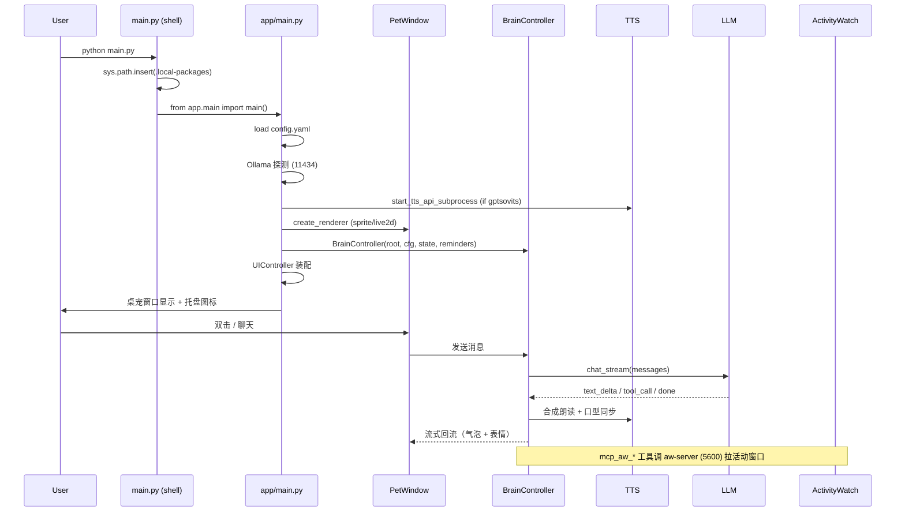
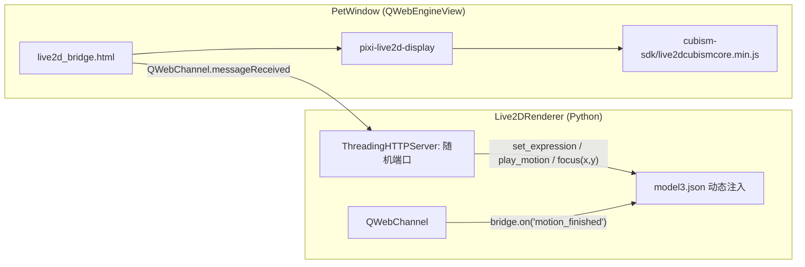
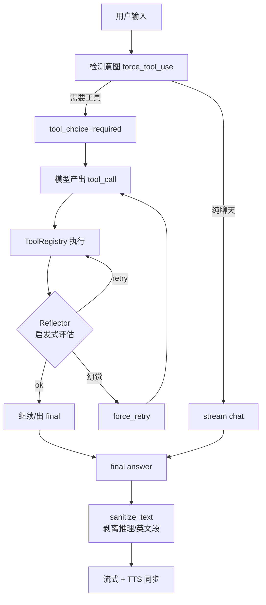
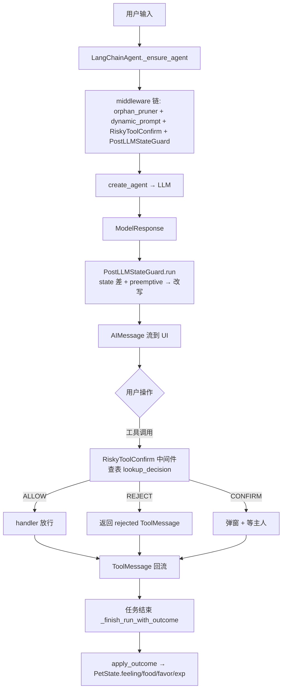
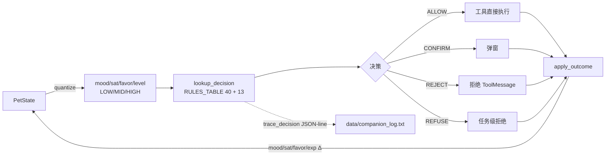
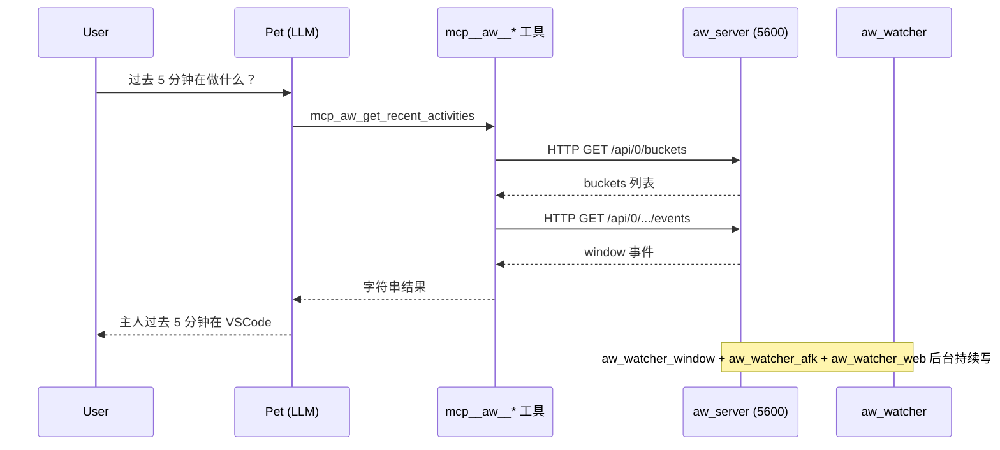

# 顶层架构

## 启动时序



`backend=standard` 时 B 内部多走一条 LangChain 链路：`_ensure_agent` 构造带 4 个 middleware 的 graph，模型响应经 `PostLLMStateGuard` 拦截改写，工具调用经 `RiskyToolConfirm` 查表。

## Live2D 渲染子图



内置 `ThreadingHTTPServer`（随机端口）绕过 Chromium CORS，让 PIXI 能直接 `fetch('model3.json')`。HTTP handler 回传 `model3.json` 时动态注入 `Motions`（idle / Zzz）与 `Expressions` 段，原模型文件不动，桥端自动循环待机动作。

`*.model.yaml`（`assets/live2d_profiles/`）按五段声明每个模型的能力：emotions / actions / sleep / watermark / random_expression。

## Agent 调用流程

`backend=lightweight`（默认，手写 ReAct）：



抗幻觉 3 层：

1. 意图驱动 `force_tool_use`：检测「打开XX/提醒XX/记住XX/查询」类意图，第一轮请求自动带 `tool_choice="required"`
2. 强制重试 `force_retry`：模型仍只回文字 → 注入强提示重试一次
3. 强制 final 阶段：连续多轮纯调工具无文字 → 去掉 tools 强制模型给出 final answer

`backend=standard`（LangChain）走 `langchain_agent.py`：



Post-LLM 拦截器（`PostLLMStateGuard`）跟 prompt-time 的 `grounding_dynamic_prompt` 互为冗余。详见 [innovation-2-companion-policy.md](innovation-2-companion-policy.md) 第 4 节。

## 决策耦合（创新点 2）



`S` 量化 → 查表 → 决策 → 工具执行 → outcome 反馈写回 `S`，闭环。决策每条 JSON-line 落 `data/companion_log.txt` 供 Dashboard `/api/companion` 读。

## 活动感知（ActivityWatch）



`mcp_aw_*` 4 个工具：`get_recent_activities` / `current_window` / `query` / `buckets`。3 种错误信息（server 没跑 / 没装 watcher / watcher 没在记）让 LLM 能告诉主人怎么修。详见 [activitywatch-integration.md](activitywatch-integration.md)。

## 文件分层

```
┌──────────────────────────────────────────────────────────┐
│  UI: app/ui/{pet_window, chat_window, ui_controller} │
├──────────────────────────────────────────────────────────┤
│  Animation: app/animation/{sprite_renderer, live2d_renderer, factory} │
├──────────────────────────────────────────────────────────┤
│  Brain: app/brain/{agent, llm_client, memory, proactive, langchain_agent, companion_policy, _companion_registry, _companion_log, hallucination_guard} │
├──────────────────────────────────────────────────────────┤
│  Voice: app/voice/{voice, gptsovits_tts, minimax_tts, asr, character} │
├──────────────────────────────────────────────────────────┤
│  Engine: app/engine/{state, tools/*, chat_store, reminder, dashboard} │
├──────────────────────────────────────────────────────────┤
│  Core: app/core/{config, settings_store, save, tray, app_registry, companion_config.yaml} │
├──────────────────────────────────────────────────────────┤
│  MCP: app/mcp/{filesystem_server, activitywatch_server, protocol} │
├──────────────────────────────────────────────────────────┤
│  Infra: Web Dashboard, Eval, Agents (sub-agents) │
└──────────────────────────────────────────────────────────┘
```

`app/brain/` 跟 v21 比新增了 4 个文件（`companion_policy` / `_companion_registry` / `_companion_log` / `hallucination_guard.PostLLMStateGuard`）。`app/core/companion_config.yaml` 独立承载创新点 2 数值公式 + 阈值 + 钩子。
